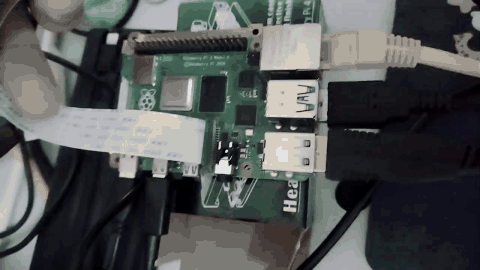
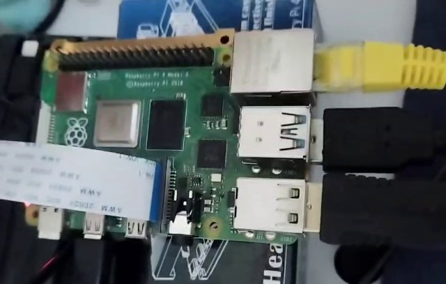
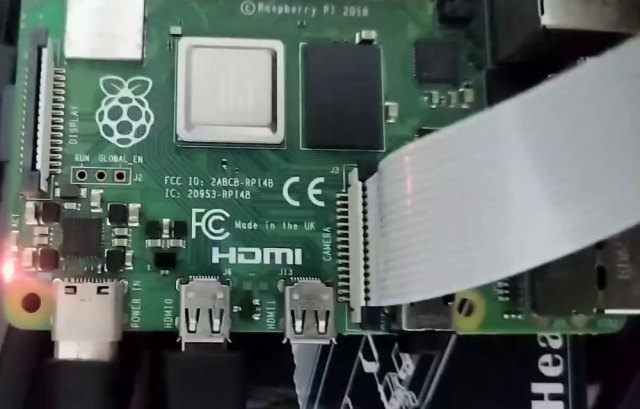
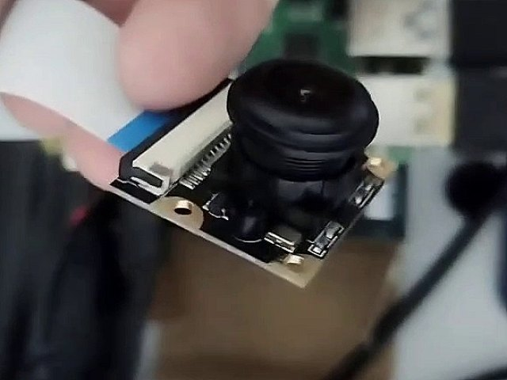
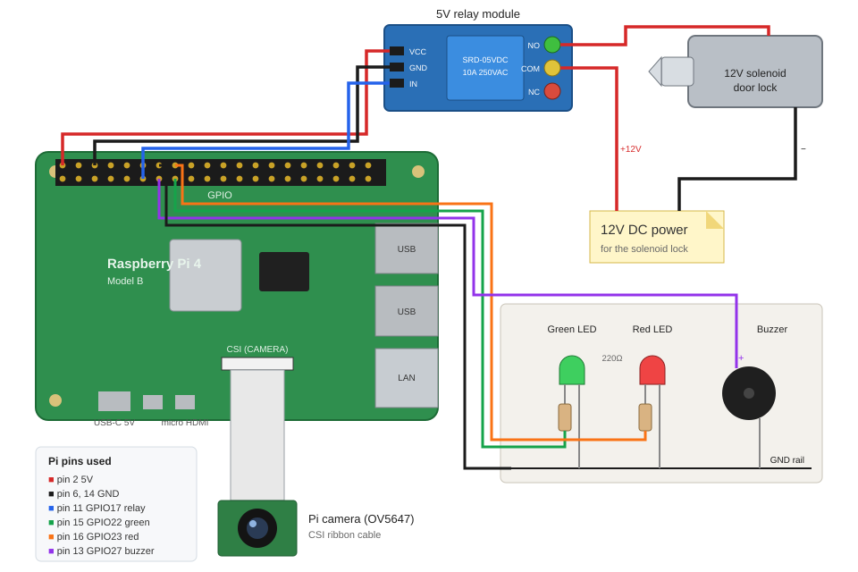
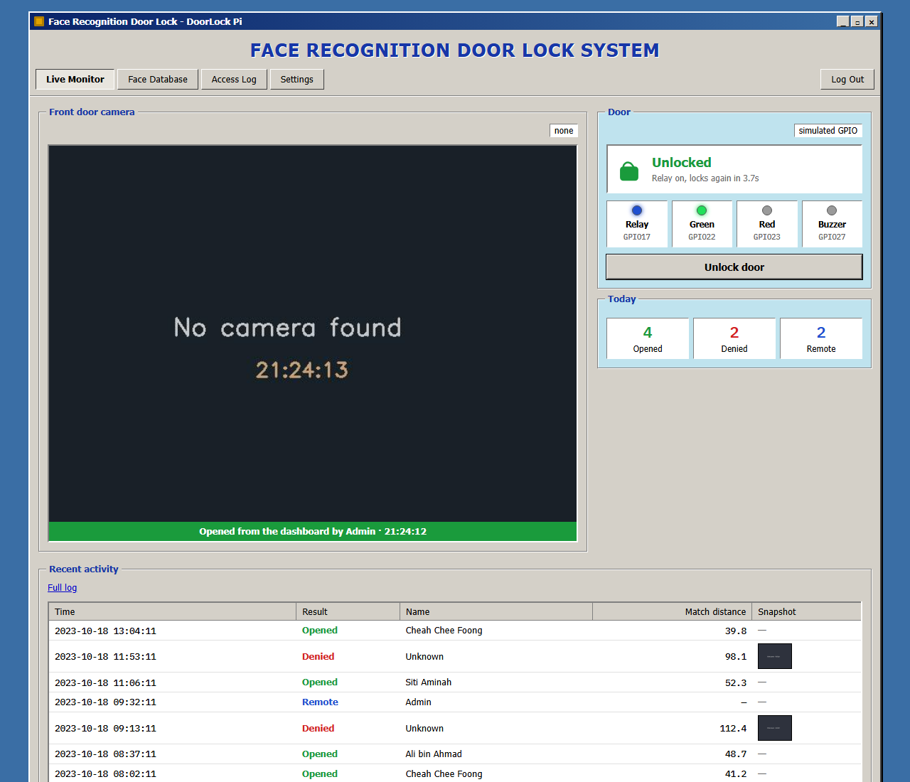
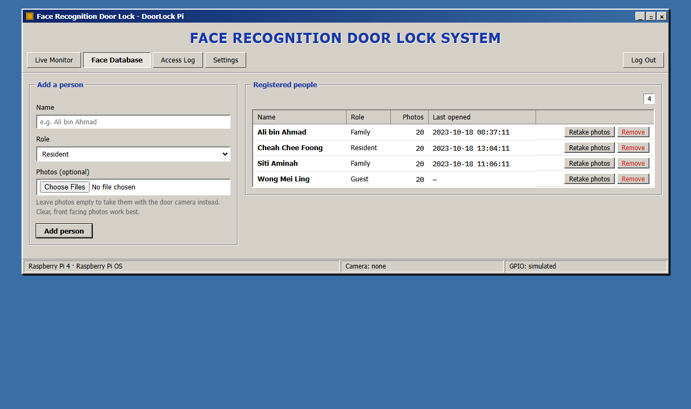
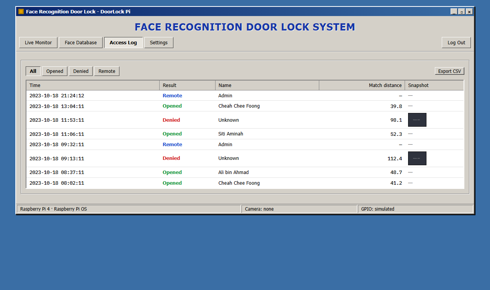
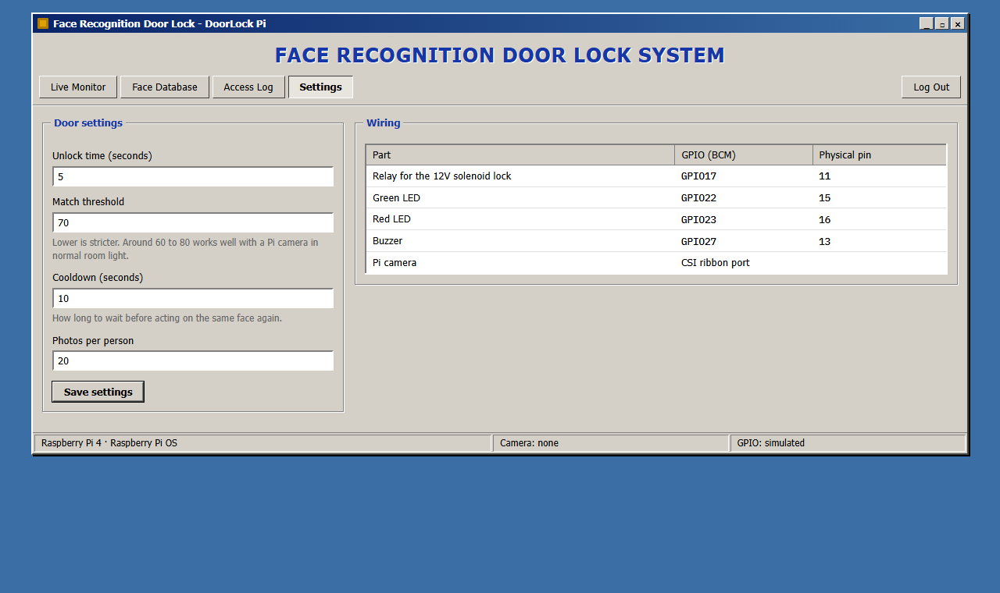

# Face Recognition Door Lock System by Using Raspberry Pi 4


My Diploma final year project. A Raspberry Pi 4 watches the front door through a Pi camera, recognises registered faces and opens a 12V solenoid lock through a relay. Unknown faces are refused, photographed and logged. A web dashboard on the Pi shows the live camera, the door state and the access log.



## Final Year Project

| | |
|---|---|
| Programme | Diploma in Electronic Engineering (Computer) |
| Institution | Sultan Azlan Shah Polytechnic, Behrang |
| Year | 2023 |
| OS | Raspberry Pi OS (Linux) |

## Hardware

| Part | Used for |
|---|---|
| Raspberry Pi 4 Model B | Runs face recognition and the dashboard |
| Pi camera (OV5647, CSI) | Live video of the door |
| 1-channel 5V relay module | Switches the lock power |
| 12V solenoid door lock + 12V adapter | The lock itself |
| Green and red LEDs + 220Ω resistors | Access granted / denied |
| Active buzzer | Short beep on open, long beep on deny |

| Overview | Board and relay | Camera |
|---|---|---|
|  |  |  |

## Wiring



| Part | GPIO (BCM) | Physical pin |
|---|---|---|
| Relay IN | GPIO17 | 11 |
| Green LED | GPIO22 | 15 |
| Red LED | GPIO23 | 16 |
| Buzzer | GPIO27 | 13 |
| Relay VCC / GND | 5V / GND | 2 / 6 |
| Pi camera | CSI port | - |

The relay board is active low. The 12V supply goes through the relay COM and NO contacts to the lock, so the lock only gets power while the relay is on.

## How It Works

1. The camera frame is turned to grayscale and faces are found with a Haar cascade.
2. Each face is cropped to 200×200 and checked with an LBPH face recogniser.
3. If the match distance is under the threshold, the relay opens the lock for a few seconds, the green LED lights and the buzzer beeps once.
4. Otherwise the red LED lights, the buzzer gives a long beep and a snapshot is saved.
5. Every result goes into a SQLite access log. The same face is ignored for a short cooldown so one visit is logged once.

## Dashboard

| Page | What it does |
|---|---|
| Live Monitor | Live camera with face boxes, lock state, GPIO lights, remote unlock and today's counts |
| Face Database | Add a person with photos, or take 20 photos with the door camera. Retake or remove people |
| Access Log | Every open, deny and remote unlock with snapshots of unknown faces. Export as CSV |
| Settings | Unlock time, match threshold, cooldown and photos per person. Wiring table |



| Face Database | Access Log |
|---|---|
|  |  |

| Settings | Login |
|---|---|
|  |  |

## Getting Started

On the Raspberry Pi:

```bash
sudo apt install -y python3-picamera2 python3-venv
git clone https://github.com/cheah20/FaceRecognitionDoorLock.git
cd FaceRecognitionDoorLock
python3 -m venv --system-site-packages .venv
.venv/bin/pip install -r requirements.txt
DOORLOCK_PASSWORD=your-password .venv/bin/python app.py
```

Open `http://<pi-address>:5000` from any device on the same network.

To start it on boot:

```bash
sudo cp deploy/doorlock.service /etc/systemd/system/
sudo systemctl enable --now doorlock
```

Stop it with `sudo systemctl stop doorlock`.

| Variable | Default | Meaning |
|---|---|---|
| `DOORLOCK_PASSWORD` | `admin` | Dashboard password |
| `DOORLOCK_SECRET` | random | Session key |
| `DOORLOCK_DATA` | `data/` | Faces, snapshots, database and model |
| `PORT` | `5000` | Web port |

On a normal PC the app still runs: it uses a USB webcam if there is one, and the GPIO parts are shown on the dashboard instead of driving real pins.

## Project Structure

```text
FaceRecognitionDoorLock/
├── app.py              # flask routes
├── doorlock/
│   ├── camera.py       # pi camera or webcam
│   ├── faces.py        # haar cascade + lbph
│   ├── hardware.py     # relay, leds, buzzer
│   ├── engine.py       # recognise and open the door
│   ├── db.py           # sqlite access log
│   └── config.py       # pins and settings
├── templates/          # dashboard pages
├── static/             # css and js
├── tests/              # pytest
├── deploy/             # systemd service
└── docs/               # photos, wiring, screenshots
```

Run the tests with `pytest`.

